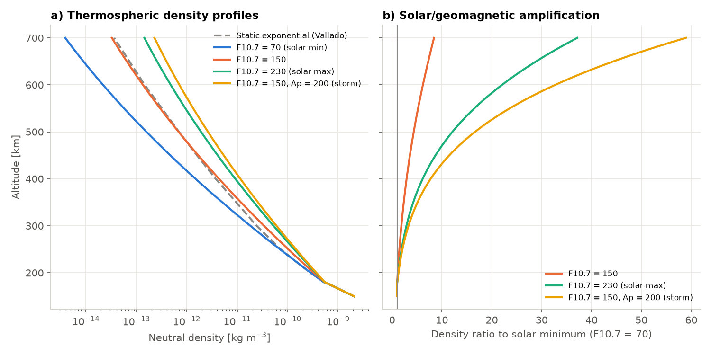
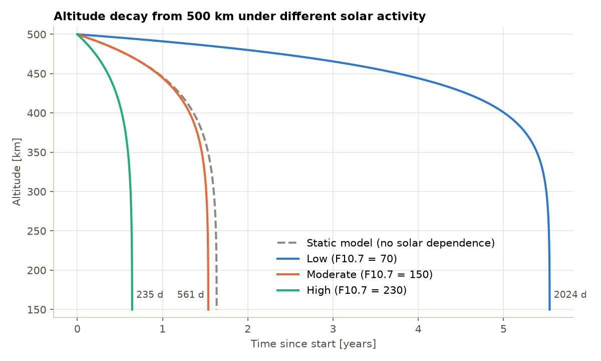
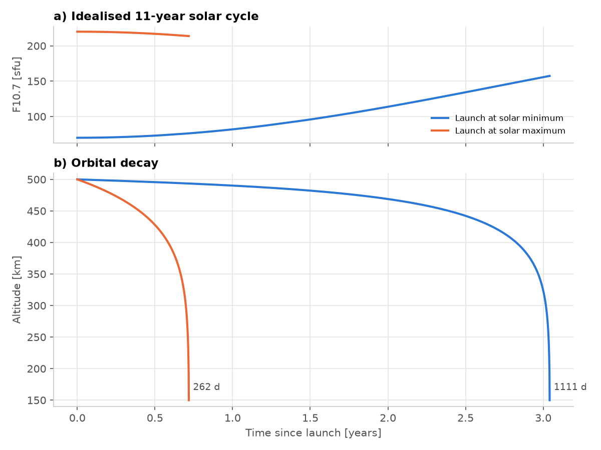
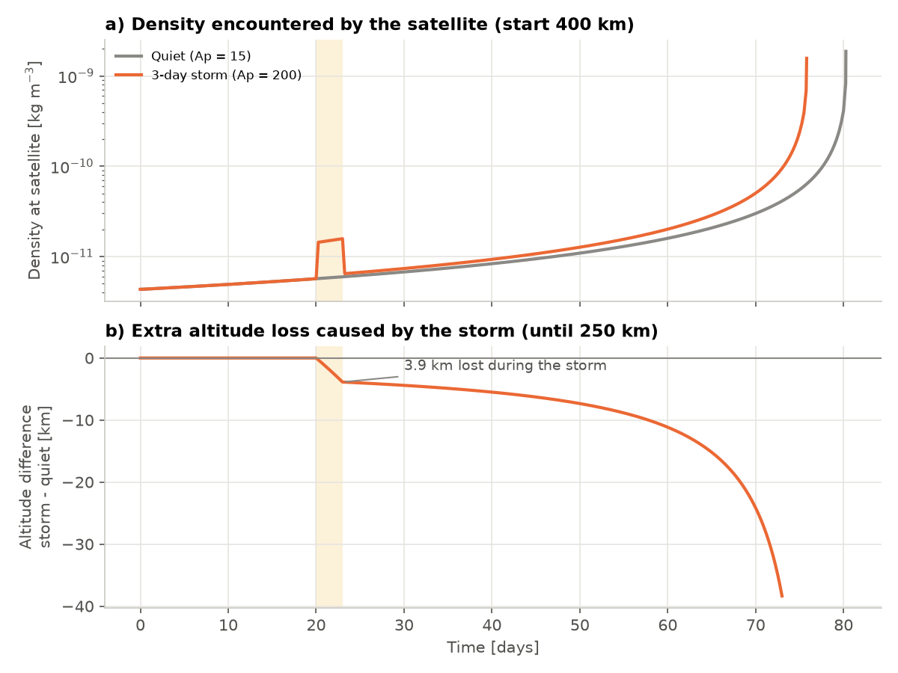
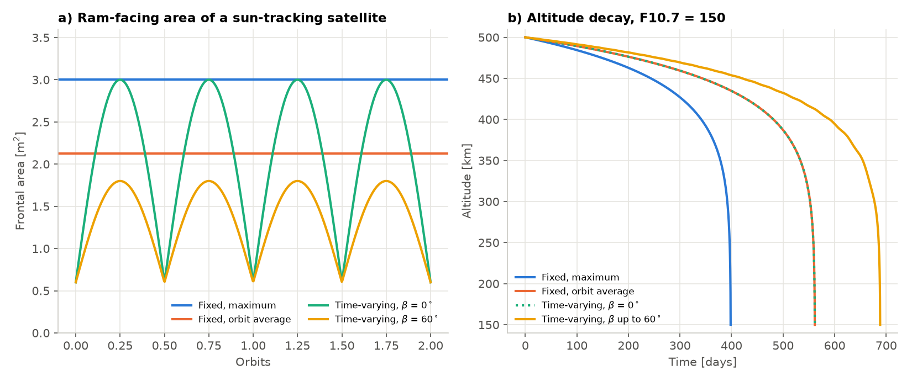
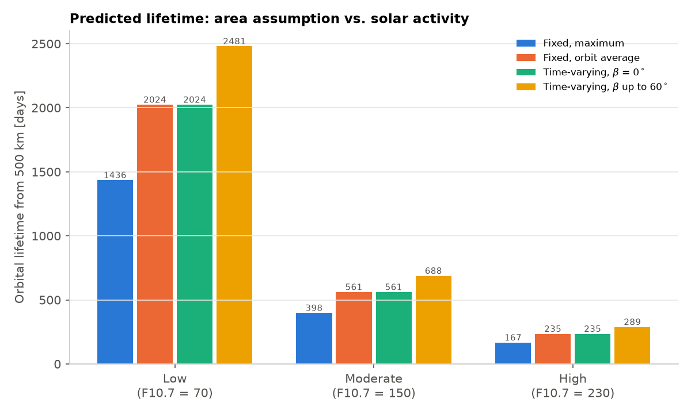
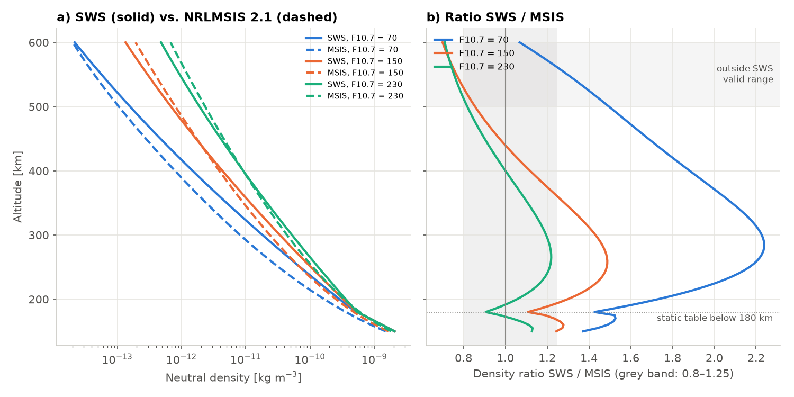

# Upper Atmosphere Density & LEO Satellite Drag Analysis

**Python · Fortran · Linux**

A small numerical study of how the **thermospheric density** responds to solar and
geomagnetic activity, and how this changes the **atmospheric drag** and **orbital
lifetime** of a satellite in Low Earth Orbit (LEO). The second part compares two ways
of modelling the satellite's frontal area: a **fixed frontal area** vs. a **time-varying
solar array area** that follows the Sun along the orbit.

The physics (density model + orbit integration) is written in **Fortran 90**, and the
experiments, post-processing and plots are done in **Python**. Everything runs on
Linux with `gfortran`, `make` and `bash`.

---

## Motivation

From a meteorology point of view, the thermosphere (~90–600 km) behaves very
differently from the lower atmosphere: it is heated mostly by solar EUV radiation
and by energy from geomagnetic storms. When the Sun is active, the thermosphere warms,
expands, and the density at a fixed altitude can increase by an order of magnitude.
For satellites this means more drag and faster orbital decay, which matters for
mission lifetime, collision avoidance and space debris.

## Method

### 1. Thermospheric density

Two models are implemented in [`src/atmosphere.f90`](src/atmosphere.f90):

| Model | Description | Solar dependence |
|---|---|---|
| `static` | Piecewise exponential atmosphere, 0–1000 km (Vallado [1]) | none (reference) |
| `sws` | Semi-empirical model from the SWS / IPS orbital decay note [2] | F10.7 and Ap |

The `sws` model computes an exospheric temperature from the solar radio flux
F10.7 (a proxy for EUV) and the geomagnetic index Ap, then builds a scale height
from it:

$$T = 900 + 2.5\,(F_{10.7} - 70) + 1.5\,A_p \quad [\mathrm{K}]$$

$$m = 27 - 0.012\,(h - 200) \quad [\mathrm{amu}], \qquad H = T/m \quad [\mathrm{km}]$$

$$\rho = 6\times10^{-10}\,\exp\!\left(-\frac{h-175}{H}\right) \quad [\mathrm{kg\,m^{-3}}]$$

A hotter thermosphere gives a larger scale height, so density falls off more slowly
with altitude. Below 180 km the program switches to the static table.

### 2. Orbital decay

For a near-circular orbit the drag force changes the semi-major axis $a$ as

$$\frac{da}{dt} = -\rho\,\frac{C_D A}{m}\,\sqrt{\mu a}, \qquad \frac{du}{dt} = \sqrt{\frac{\mu}{a^3}}$$

where $u$ is the position along the orbit measured from the Sun direction. The system
is integrated with a **4th-order Runge–Kutta** scheme (Δt = 60 s, about 90 steps per
orbit) until the altitude reaches 150 km, which I take as re-entry. See
[`src/orbit_decay.f90`](src/orbit_decay.f90).

### 3. Solar activity scenarios

[`src/space_weather.f90`](src/space_weather.f90) provides:
- constant F10.7 levels: **70** (solar minimum), **150** (moderate), **230** (solar maximum)
- an idealised **11-year solar cycle**, $F_{10.7}(t) = F_{min} + (F_{max}-F_{min})\sin^2(\pi t / 11\,\mathrm{yr})$
- an optional **geomagnetic storm** (Ap = 200 for 3 days, otherwise Ap = 15)

### 4. Frontal area models

The test satellite is a 150 kg box (0.6 m² ram face) with two sun-tracking solar wings
(2.4 m² total), with $C_D = 2.2$. Because the arrays always point at the Sun, the part
of their area facing the flow changes along the orbit
([`src/spacecraft.f90`](src/spacecraft.f90)):

$$A(u) = A_{body} + A_{panel}\,|\cos\beta\,\sin u|$$

where β is the angle between the Sun and the orbit plane. Compared cases:

| `area_mode` | Assumption |
|---|---|
| `fixed_max` | arrays always face the flow: $A = A_{body} + A_{panel}$ (worst case) |
| `fixed_avg` | constant orbit-averaged area for β = 0: $A = A_{body} + \tfrac{2}{\pi}A_{panel}$ |
| `varying` | instantaneous $A(u)$; optionally β oscillates up to 60° with a 60-day period |

---

## Results

All numbers below come from `results/summary.csv` (start altitude 500 km unless noted).

### Density profiles



- At **400 km** the density goes from 1.5×10⁻¹² kg/m³ (F10.7 = 70) to
  9.1×10⁻¹² kg/m³ (F10.7 = 230), about **6×** higher. At **500 km** the factor is about **12×**:
  the higher you go, the stronger the solar effect.
- The `sws` profile for F10.7 = 150 is very close to the static Vallado table, which
  is a good sanity check (the table represents roughly average conditions).

### Effect of solar activity on orbital decay



| Solar activity | Lifetime from 500 km |
|---|---|
| Low (F10.7 = 70) | 2024 days (~5.5 years) |
| Moderate (F10.7 = 150) | 562 days |
| High (F10.7 = 230) | 235 days |
| Static model | 597 days |

The same satellite lives **~8.6 times longer** at solar minimum than at solar maximum.
Most of the lifetime is spent above ~400 km; once the satellite gets lower, the decay
speeds up very quickly because density grows exponentially.



With a solar cycle, the **launch date** matters: launched at solar minimum the satellite
lasts **1111 days**, but launched at solar maximum it only lasts **262 days**.



A 3-day geomagnetic storm (start 400 km) roughly triples the density during the event
and makes the satellite lose about **3.9 km** of extra altitude. The difference keeps
growing after the storm because a lower orbit sees more drag, and the lifetime goes
from 80.3 to 75.8 days.

### Fixed vs. time-varying solar array area




| F10.7 | Fixed max | Fixed orbit avg | Varying (β = 0) | Varying (β up to 60°) |
|---|---|---|---|---|
| 70 | 1436 d | 2024 d | 2024 d | 2481 d |
| 150 | 398 d | 562 d | 562 d | 688 d |
| 230 | 167 d | 235 d | 235 d | 289 d |

- Assuming the arrays always face the flow (**fixed max**) gives a lifetime about
  **29 % shorter** than the time-varying model. It is conservative, but too pessimistic.
- With β = 0 the time-varying model gives **the same lifetime as the orbit-averaged
  fixed area**. The area changes every ~45 minutes while the orbit decays over months,
  so the satellite effectively "feels" only the average area.
- When the **β angle changes** (orbit precession), the arrays are often tilted away
  from the flow and the average area drops, so the lifetime increases by about **23 %**.
  A single fixed area cannot represent this, so the geometry has to be modelled.
- The relative effect of the area assumption is almost the same at all solar activity
  levels, because both act as simple multipliers in the drag equation. Solar activity
  is still the bigger source of uncertainty (a factor of ~8 vs. ~1.7).

### How good is the simple density model? (comparison with NRLMSIS 2.1)



To check the simple `sws` model, I compared it with **NRLMSIS 2.1**, an empirical
model widely used in research, through the `pymsis` Python package
([`python/compare_msis.py`](python/compare_msis.py)). MSIS depends on latitude, local
time and season, so I averaged it over the globe (cos-latitude weighted, 5°×10° grid)
on the March equinox and the June solstice, using the same F10.7 and Ap values.

| F10.7 | SWS / MSIS at 300 km | at 400 km | at 500 km |
|---|---|---|---|
| 70 | 2.23 | 1.88 | 1.50 |
| 150 | 1.43 | 1.12 | 0.86 |
| 230 | 1.20 | 1.00 | 0.82 |

- For moderate and high activity, the simple model stays within about **±20 %** of
  MSIS at 400–500 km, which is good for a single-equation model.
- At **solar minimum** it gives up to **2× too much density** at 300–400 km, because a
  single linear temperature law cannot capture how strongly the thermosphere cools and
  contracts at low activity. This means the low-activity lifetimes above are
  probably **too short**. The conclusions about the area assumptions are not affected,
  since those are relative comparisons with the same density.

### Validation of the code

Results are in [`results/validation.md`](results/validation.md) ([`python/validate.py`](python/validate.py)).

1. **Reproducing a published example.** Section 4 of the SWS note gives an example run
   (100 kg, A·C_D = 1 m², start 300 km, F10.7 = 70, Ap = 0, re-entry at 180 km) that
   re-enters after **46 days**. My code gives **46.9 days** (+2 %). The small difference
   is expected because the original QBASIC program uses an Euler step of 0.1 day,
   while my code uses RK4 with a 60 s step.
2. **Time-step convergence.** The lifetime of the 500 km case is the same to 0.01 days
   for steps from 15 s to 900 s, and changes by only 0.04 % even with 2 steps per orbit.
   The 60 s step used in the project is therefore more than accurate enough.

---

## How to run

Requirements: Linux, `gfortran`, `make`, Python 3 with `numpy` and `matplotlib`
(`pymsis` is only needed for the MSIS comparison).

```bash
git clone https://github.com/rabia-e-6a7821242/leo-drag-analysis.git
cd leo-drag-analysis
python3 -m venv .venv && .venv/bin/pip install -r requirements.txt
bash scripts/run_all.sh
```

This builds the Fortran code, writes the namelist input files to `runs/`, runs all
20 cases (~10 s in total), runs the validation and the MSIS comparison, and saves the
CSV data, figures and tables to `results/`.

To run a single case by hand:

```bash
make
./bin/orbit_decay runs/solar_moderate.nml my_output.csv
```

Input namelist example (every parameter is optional; defaults are in the Fortran modules):

```fortran
&satellite   mass_kg = 150, cd = 2.2, area_body = 0.6, area_panel = 2.4,
             area_mode = 'varying', beta_amp_deg = 60 /
&orbit       h0_km = 500, h_end_km = 150 /
&environment density_model = 'sws', solar_mode = 'constant', f107_const = 150,
             ap_quiet = 15 /
&run         dt_s = 60, out_dt_s = 21600, t_max_day = 9131 /
```

## Repository structure

```
├── src/                  Fortran source
│   ├── constants.f90       physical constants
│   ├── atmosphere.f90      static + solar-driven density models
│   ├── space_weather.f90   F10.7 / Ap time series
│   ├── spacecraft.f90      satellite properties, frontal area model
│   ├── orbit_decay.f90     main program, RK4 integration
│   └── density_profile.f90 writes density vs. altitude tables
├── python/
│   ├── run_scenarios.py    builds namelists, runs all cases, summary.csv
│   ├── plot_results.py     figures + summary.md
│   ├── validate.py         SWS example run + time-step convergence
│   └── compare_msis.py     comparison with NRLMSIS 2.1 (pymsis)
├── scripts/run_all.sh    full pipeline
├── runs/                 generated namelist input files
├── results/              CSV output, figures, summary tables
└── Makefile
```

## Limitations

This is a simplified model made for learning, not for operational predictions:
- Circular orbit only (no eccentricity), no J2 or other perturbations. β is a simple
  sine function instead of being computed from the real orbit precession and Sun position.
- The `sws` density model is a fit to a single exponential profile and is meant for
  roughly 180–500 km. It has no day/night, latitude or seasonal variation, and it
  overestimates density at solar minimum compared with NRLMSIS 2.1 (see above).
  The orbit simulations use the simple model, not MSIS.
- The SWS note recommends a 90-day mean F10.7; here F10.7 is either constant or a smooth
  cycle, so daily vs. averaged flux makes no difference.
- F10.7 and Ap are idealised (constant, sinusoidal cycle, box-shaped storm) instead of
  observed indices.
- $C_D$ is constant; in reality it depends on the gas–surface interaction and the shape.
- The solar arrays are treated as flat plates with no thickness and no self-shadowing.

Possible next steps: use MSIS directly inside the orbit integration, read observed
F10.7/Ap from NOAA SWPC, and compare with a real decayed object's TLE history.

## Sources: what comes from where

| Part of the project | Source | Where in the code |
|---|---|---|
| Static density table (28 layers, 0–1000 km) | Vallado (2013), Ch. 8, exponential atmospheric model table [1]; values cross-checked with the SatelliteToolbox implementation [7] | `src/atmosphere.f90` |
| Solar-driven density model (T, m, H, ρ equations, 180–500 km) | SWS / IPS note, section 2 [2] | `src/atmosphere.f90` |
| Validation case (100 kg, 1 m², 300 km → 46 days) | SWS / IPS note, section 4 [2] | `python/validate.py` |
| Re-entry criterion (180 km in the note; 150 km used here) | SWS / IPS note, section 3 [2] | namelist `h_end_km` |
| Drag decay of a circular orbit, da/dt = −ρ(C_D A/m)√(μa) | Standard result, derived from the drag force and orbital energy; see King-Hele [3] and Vallado [1]. The SWS note gives the equivalent form dP/dt = −3πaρ(A_e/m) [2] | `src/orbit_decay.f90` |
| RK4 integration | Classical 4th-order Runge–Kutta method (any numerical methods textbook) | `src/orbit_decay.f90` |
| μ = 3.986004418×10¹⁴ m³/s², R_E = 6378.137 km | WGS-84 constants | `src/constants.f90` |
| Sun-tracking solar array frontal area, A = A_body + A_panel·\|cos β sin u\| | My own derivation (dot product of Sun and velocity unit vectors) | `src/spacecraft.f90` |
| Satellite properties (150 kg, 0.6 + 2.4 m², C_D = 2.2) | My own choice of a typical small satellite; C_D ≈ 2.2 is the usual textbook value [1] | `python/run_scenarios.py` |
| F10.7 levels, 11-year sin² cycle, storm with Ap = 200 | My own idealised scenarios, chosen inside the ranges given in [2] (F10.7 ≈ 65–300, Ap up to 400) | `src/space_weather.f90`, `python/run_scenarios.py` |
| Reference density model for comparison | NRLMSIS 2.0 [5] with the NO update of 2.1 [6], via `pymsis` [8] | `python/compare_msis.py` |
| Background on thermospheric density | Emmert (2015) [4] | README |

## References

1. Vallado, D. A. (2013). *Fundamentals of Astrodynamics and Applications*, 4th ed. Microcosm Press / Springer.
2. IPS Radio and Space Services, Bureau of Meteorology (Australian Space Weather Agency). *Satellite Orbital Decay Calculations*. https://www.sws.bom.gov.au/Category/Educational/Space%20Weather/Space%20Weather%20Effects/SatelliteOrbitalDecayCalculations.pdf
3. King-Hele, D. (1987). *Satellite Orbits in an Atmosphere: Theory and Applications*. Blackie, Glasgow.
4. Emmert, J. T. (2015). Thermospheric mass density: A review. *Advances in Space Research*, 56(5), 773–824.
5. Emmert, J. T. et al. (2021). NRLMSIS 2.0: A whole-atmosphere empirical model of temperature and neutral species densities. *Earth and Space Science*, 8, e2020EA001321.
6. Emmert, J. T. et al. (2022). NRLMSIS 2.1: An empirical model of nitric oxide incorporated into MSIS. *Journal of Geophysical Research: Space Physics*, 127(10), e2022JA030896. https://doi.org/10.1029/2022JA030896
7. SatelliteToolboxAtmosphericModels.jl, exponential atmosphere constants. https://github.com/JuliaSpace/SatelliteToolboxAtmosphericModels.jl
8. pymsis: Python interface to the NRLMSIS models. https://github.com/SWxTREC/pymsis
